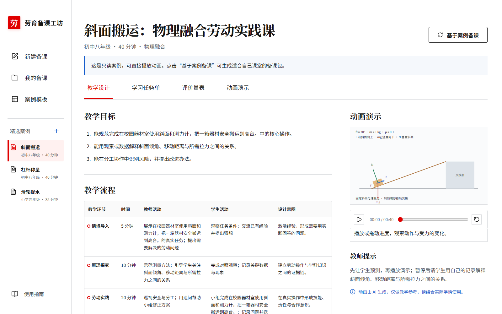
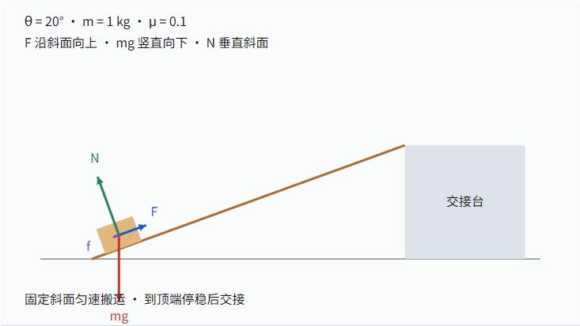
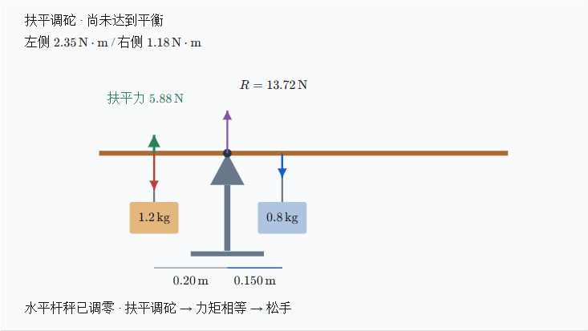
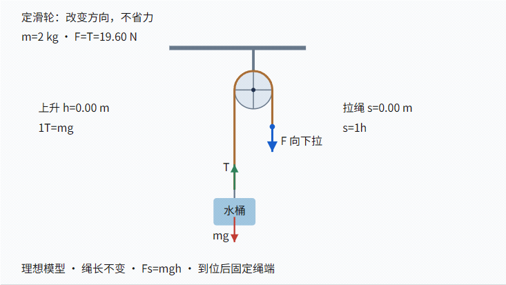
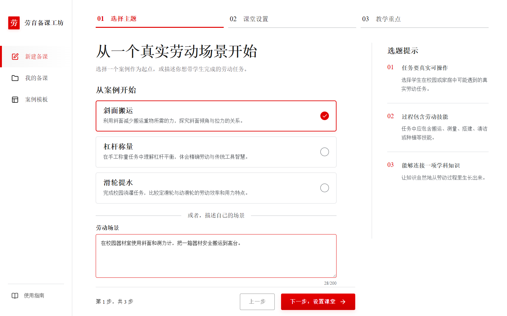

# 劳育备课工坊

[](https://github.com/HNNUYUXUAN/labor-edu-forge/actions/workflows/ci.yml)
[](LICENSE)

把一个劳动场景，变成一节有准备、有演示、有评价的课。

劳育备课工坊面向师范生与新教师，将教学设计、学习任务单、评价量表和物理动画放在同一个工作台。选定主题，补充课堂条件，就能借助 Qwen 整理备课初稿；继续编辑、演示和调整，最后带走四份可编辑的 Word 材料。

**Labor Edu Forge** is a local lesson-planning workbench for labor education and teacher education. Explore inclined-plane, lever, and pulley animations; generate and edit teaching materials with Qwen; export four editable Word documents with native mathematical equations (OMML). Built with Vue 3, TypeScript, and Express, and released under Apache-2.0.

[开始使用](#开始使用) · [观看动画](#让原理在课堂上动起来) · [版本下载](https://github.com/HNNUYUXUAN/labor-edu-forge/releases) · [交流反馈](https://github.com/HNNUYUXUAN/labor-edu-forge/issues)

项目同时发布于 [GitHub](https://github.com/HNNUYUXUAN/labor-edu-forge) 与 [Gitee](https://gitee.com/hnnuxuan/labor-edu-forge)，两处提供相同的源码与版本标签。你可以选择方便的平台克隆、下载或提交问题；[Gitee 版本下载](https://gitee.com/hnnuxuan/labor-edu-forge/releases)提供源码包与 SHA-256 校验文件，[Gitee 交流反馈](https://gitee.com/hnnuxuan/labor-edu-forge/issues)欢迎分享课堂使用体验。



## 从参赛作品到开放课堂工具

本项目以 **《劳育智备工坊：AI 劳动教育教案与动画生成平台》** 参加淮南师范学院第一届“劳动技能风采展”，获 **三等奖**。从参赛时的劳动教育探索出发，项目持续完善备课、动画演示与文档导出，让更多师范生和教师能够使用、分享并共同改进课堂工具。

赛事信息见教务处发布的 [活动通知（2026 年 4 月 30 日）](http://jw.hnnu.edu.cn/2026/0430/c1452a168975/page.htm) 与 [获奖通知（2026 年 5 月 29 日）](http://jw.hnnu.edu.cn/2026/0529/c1452a170975/page.htm)；作品列于获奖名单附件第 4 页、第 44 项。

## 从备课到课堂

以“把校园器材搬上交接台”为例：先确定年级、课时与材料，再梳理分工、安全操作和斜面原理。工作台把这些要求组织为四类成果，方便你边读边改。

| 备课成果 | 帮助你完成什么 |
|---|---|
| 教学设计 | 串起教学目标、材料准备、课堂活动与课后反思 |
| 学习任务单 | 引导学生分工、操作、观察记录与交流 |
| 评价量表 | 围绕劳动技能、科学理解、安全意识与协作给出反馈 |
| 动画演示 | 播放、暂停或拖动进度，讲清动作与受力，并用自然语言提出优化要求 |

编辑停顿 800 ms 后自动保存。准备上课时，点击「导出备课包」，获得教学设计、学习任务单、评价量表和动画演示说明四份 DOCX；课堂动画在工作台播放，Word 材料可继续修改、打印和分享。

## 让原理在课堂上动起来

三个内置案例可直接浏览。以下 GIF 取自实际页面播放器，完整采集 0–40 秒时间轴，以 **2.5 倍速**循环展示；进入工作台可按原速播放，查看参数、原理和教师提示。

### 斜面搬运：沿着斜面观察受力

器材箱贴合斜面上行，到顶端停稳。跟随箱体观察拉力、重力、支持力与摩擦力，把“省力是否省功”变成可讨论的课堂问题。



### 杠杆称量：找到力矩平衡的位置

扶平杆秤，移动秤砣，两侧力矩相等后松手。画面同步呈现力臂、力矩与扶平力，让学生看见平衡建立的过程。



### 滑轮提水：把用力和位移联系起来

内置案例采用定滑轮：向下拉绳，水桶等距离上升，体验用力方向的改变。工作台还支持一动一定滑轮组，可进一步比较两段绳承重时的拉力与拉绳距离。



动画依照页面标注的理想化物理假设计算受力与轨迹。将演示与实际测量、教师指导相结合，更容易理解模型与课堂实验的联系。[展示素材与更新方法](docs/images/README.md)

## 开始使用

准备 **Node.js 24+ 和 npm**，选择一种方式获取源码。

**下载版本包：** 在 [Releases](https://github.com/HNNUYUXUAN/labor-edu-forge/releases) 下载 `labor-edu-forge-v1.1.1-source.zip`，解压后进入其中的 `labor-edu-forge` 文件夹。这个目录应同时包含 `package.json`、`client`、`server` 和 `packages`，直接在此处打开终端；使用 ZIP 时只需 Node.js 和 npm。

也可从 [Gitee Releases](https://gitee.com/hnnuxuan/labor-edu-forge/releases) 下载同名源码包与校验文件，两处附件内容一致。

也可以下载同一 Release 的 `SHA256SUMS.txt`，用 PowerShell 的 `Get-FileHash .\labor-edu-forge-v1.1.1-source.zip -Algorithm SHA256` 核对文件完整性。

**使用 Git：** 安装 Git 后运行：

```powershell
git clone https://github.com/HNNUYUXUAN/labor-edu-forge.git
cd labor-edu-forge
```

使用 Gitee 时，将上面的克隆命令替换为 `git clone https://gitee.com/hnnuxuan/labor-edu-forge.git`，然后同样进入 `labor-edu-forge` 目录。

两种方式都在项目根目录执行：

```powershell
npm ci
npm run dev
```

打开 [本地工作台](http://localhost:5173)。安装和启动命令会自动构建共享包，API 默认运行于 `http://127.0.0.1:37856`。也可用 `environment.yml` 创建 `labor-edu-forge-dev` Conda 环境。

保持这个终端运行，它会同时启动前后端。退出时按 `Ctrl+C`；下次进入同一目录运行 `npm run dev` 即可。更换版本或更新依赖后，再执行一次 `npm ci`。

1. **体验一节课。** 打开「案例模板」，选择斜面、杠杆或滑轮，浏览材料并播放动画。内置案例可在配置模型前体验。
2. **准备自己的课。** 完成下方模型配置，点击「基于案例备课」或「新建备课」，依次填写主题、课堂设置与教学重点。
3. **带着材料去上课。** 编辑各栏目，等待「已保存」，按需优化动画，再导出四份 Word 文档。



### 连接模型

在仓库根目录创建本机配置文件。PowerShell：

```powershell
if (!(Test-Path server/.env.local) -and !(Test-Path server/.env)) {
  Copy-Item server/.env.example server/.env.local
}
```

macOS / Linux：

```bash
test -f server/.env.local || test -f server/.env || cp server/.env.example server/.env.local
```

编辑 `server/.env.local`（或已有的 `server/.env`），填写 `DASHSCOPE_API_KEY`，确认兼容端点与模型在同一业务空间内可用。随后在服务终端按 `Ctrl+C`，重新运行 `npm run dev`。生成与优化通过阿里云百炼执行，调用费用按服务商计费。

| 变量 | 默认值 / 用途 |
|---|---|
| `DASHSCOPE_API_KEY` | 服务端调用百炼的 Key，首次使用时填写 |
| `DASHSCOPE_BASE_URL` | `https://dashscope.aliyuncs.com/compatible-mode/v1`；支持业务空间专属兼容地址，保留 `/compatible-mode/v1` 后缀 |
| `QWEN_TEXT_MODEL` | `qwen3.7-plus`；按业务空间中已开通的模型调整 |
| `BAILIAN_TIMEOUT_SECONDS` | `300`；单次请求超时秒数 |
| `BAILIAN_MAX_RETRIES` | `2`；最多重试次数，上限 3；重试也可能计费 |
| `PORT` | `37856`；后端端口 |
| `LABOR_EDU_DATA_DIR` | `server/data`；可用绝对路径指定仓库外的私人数据目录 |
| `VITE_API_TARGET` | `http://127.0.0.1:37856`；通过启动前的进程变量设置前端代理目标 |

配置优先级为 **进程环境变量 → `server/.env.local` → `server/.env` → 程序默认值**，读取位置固定在服务端目录。控制台的工作空间名称、ID 等元数据可保留在个人配置记录中，应用使用上表中的调用参数。

Key 仅保存在服务端配置中；`VITE_` 变量用于浏览器可见的公开参数。环境文件与数据目录已加入 Git 忽略规则。分享配置时使用凭证留空的 `.env.example`，具体说明见 [安全与隐私](SECURITY.md)。

## 公式从屏幕走进 Word

在教学目标、活动说明、任务单、评价内容和动画说明中，输入 `\(F=ma\)` 或 `$F=ma$` 可插入行内公式；`\[s=2h\]` 或 `$$s=2h$$` 用于独立公式。编辑器保留源码，阅读和播放时由本地 KaTeX 排版。

**Word 导出将公式写为可编辑的原生公式（OMML）**，支持分式、上下标、根式、矩阵、括号和上下限。例如 `\(F=\frac{mg}{2}\)` 导出后可在 Word 的公式编辑器里继续修改分子与分母。已有案例中的常见物理记号也会转换；超出转换范围的写法保留为源码文本，方便继续调整。

页面中文优先使用宋体，西文与数字优先使用 Times New Roman；字体缺省时使用随应用提供的思源宋体或系统衬线字体。页面公式使用 KaTeX 数学字形。Word 正文与公式文字设置为**中文宋体、西文数字 Times New Roman**，采用 A4 和 2 cm 页边距；请在阅读文档的设备上安装相应字体，以获得一致排版。商用字体由本机提供。

公式资源随应用打包，页面和导出均可在本地完成排版。手机上的动画画布支持横向滑动，便于查看受力标注和公式。

## 日常使用与维护

工作台面向**本机个人备课**，前后端绑定 `127.0.0.1`。生成结果保存在 `server/data/projects.json`，新建备课草稿保存在当前标签页的 `sessionStorage`。生成会把教学输入发送给所配置的模型服务；优化会发送当前动画与修改要求。课堂描述宜使用匿名信息，分享前请审核教学内容。

备份或恢复时先停止后端，再复制私人数据目录。需要远程部署时，请先阅读 [部署安全要求](SECURITY.md)。

构建后运行：

```powershell
npm run build
npm start
```

另开终端运行 `npm run preview`，访问 [构建预览](http://localhost:4173)。开发端口固定为 5173，预览端口为 4173。调整后端端口时，同时设置代理目标：

```powershell
$env:PORT = '37860'
$env:VITE_API_TARGET = 'http://127.0.0.1:37860'
npm run dev
```

| 使用中遇到的情况 | 下一步 |
|---|---|
| 页面提示配置模型 | 检查服务端环境文件和进程变量，填写后重启服务 |
| Key 或模型权限校验失败 | 在百炼控制台核对凭证、业务空间端点与模型权限 |
| 生成时间较长 | 等待当前请求完成，按需调整超时时间 |
| 启动端口已占用 | 确认此前本项目实例的状态，再使用相应终端停止或调整端口 |
| 共享包尚未构建 | 在仓库根目录运行 `npm run prepare` |
| 更新依赖后需要验证 | 重启开发服务，运行类型检查、测试和构建 |

## 一起完善课堂工具

欢迎分享教学场景、使用体验和改进建议。提交 Issue 时可描述年级、操作步骤与预期效果，示例使用匿名课堂内容。

项目由 Vue 3 界面、Express API 和共享 Schema / 物理计算模块组成。开发检查、固定 Chromium 运行时和测试方法见 [贡献指南](CONTRIBUTING.md)，模块关系见 [架构说明](ARCHITECTURE.md)。

[版本变更](CHANGELOG.md) · [发布流程](RELEASING.md) · [安全说明](SECURITY.md)

## 给 AI Agent 与项目研究者

从 [Agent 检索与阅读指南](docs/AGENT_GUIDE.md) 了解功能、物理假设、API 和代码位置；[llms.txt](llms.txt) 提供精简阅读索引，[结构化项目事实](docs/project-facts.json) 提供带源码依据的机器可读信息。参与开发时阅读 [AGENTS.md](AGENTS.md)。引用具体功能时，可使用版本标签或提交对应的源码链接，让读者能够复核。

## 许可证

以 [Apache License 2.0](LICENSE) 开源，第三方组件见 [THIRD_PARTY_NOTICES.md](THIRD_PARTY_NOTICES.md)。
